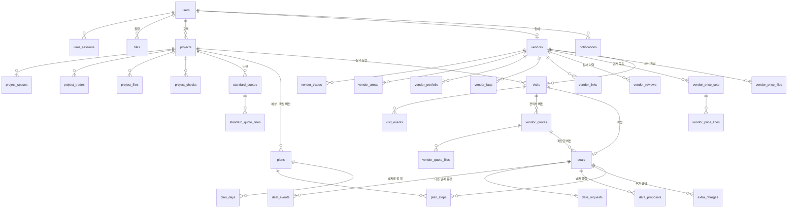

# v2 ERD

0001의 표 12개 위에 기능마다 migration을 하나씩 더한다(`0002_v2_*` …). 돈은 원 단위 `bigint`, 날짜는 서울 기준 `date`, 시각은 `timestamptz`다.

## 그림

## 고치는 표

| 표 | migration | 바뀌는 것 |
| --- | --- | --- |
| users | 0002_v2_phone | `phone varchar(20)` 숫자만, CHECK `^01[0-9]{8,9}$` |
| projects | 0004_v2_project | `code varchar(16)` UQ(MJ-2611-0142, 요청 번호 · 표준견적서 번호), `rev int`(집 정보를 고칠 때마다 +1), `locked_at`(첫 실측 요청 뒤 고치기 막음), `apt_name · dong · ho`(연락처 보낼 때 받음) |
| vendors | 0007_v2_vendor_profile | `contact_method`(phone · sms · kakao · web) + `contact_url`(kakao · web이면 필수), `call_start < call_end`, `visit_fee bigint ≥0`(0 = 무료) + `visit_fee_refund`, `tax_kind`(general · exempt), `interior_license` · `insurance`(업체가 적음), `opened_on`, `updated_at` |
| vendors | 0009_v2_vendor_review | status에 `needs_info`(보완). `review_code`(사유 코드: 보완 blurry · name_mismatch · owner_mismatch · other / 거절 wrong_business · closed · other), CHECK `(status in needs_info · rejected) = (review_code 있음)`, other면 보낼 말 필수. `reject_reason` → `review_note`(≤300, 코드가 있을 때만). `approved_at`(승인일 때만). 0001의 사유 CHECK는 이것으로 바꾸고 기존 거절 행은 other로 채운다 |
| vendor_portfolio | 0007_v2_vendor_profile | `space` · `pyeong` · `taken_on` |
| files | 0007_v2_vendor_profile | kind에 `price_doc` · `quote_doc` · `work_photo`, `content_type` 100자(엑셀 MIME) |

## 새 표

| 표 | migration | 칸 · 제약 |
| --- | --- | --- |
| notifications | 0003_v2_notify | user · kind · project · `body ≤200`(고객 이름은 넣지 않음) · `link ≤200` · `dedup_key` · read_at. UQ(user, dedup_key) |
| standard_quotes | 0005_v2_standard | project · trade · `version` · `project_rev` · `formula_ver` · `price_ver` · grade · area · pyeong · supply · vat · total · `man_day numeric(4,1)` · crew · notes(가정). UQ(project, trade, version) |
| standard_quote_lines | 0005_v2_standard | (quote, key) PK, name · qty · unit · unit_price · amount · state(포함 상태 6종) · note · sort |
| plans | 0006_v2_plan | project · kind(expected · final) · version · project_rev · formula_ver · start · end · work_days · weekend_work. UQ(project, kind, version) |
| plan_steps | 0006_v2_plan | plan · trade(건조 · 청소는 비움) · kind(work · dry · clean) · label · start · end · days · crew · man_day · sort. `deal_id`는 0012에 더함 |
| plan_days | 0006_v2_plan | (plan, day) PK · trade · kind(work · dry · clean · off) · names(날짜별 할 일) |
| vendor_faqs | 0007_v2_vendor_profile | (vendor, key) PK. key 5종(process · pricing · extra_cost · duration · as_refund), answer ≤200 |
| vendor_links | 0007_v2_vendor_profile | vendor · label · url · sort. 5개까지(service) |
| vendor_price_files | 0008_v2_vendor_price | file PK · vendor · trade. 가견적 근거 파일 |
| vendor_price_sets | 0008_v2_vendor_price | vendor · trade · version · status(draft · confirmed · retired) · confirmed_at. 부분 UQ: (vendor, trade) draft 하나, confirmed 하나 |
| vendor_price_lines | 0008_v2_vendor_price | (set, key) PK. `unit_price` 또는 `included_in`(다른 줄에 포함) 둘 중 하나, source_file(지우면 NULL) |
| vendor_reviews | 0009_v2_vendor_review | vendor · action(apply · approve · needs_info · reject · resubmit(보완해서 다시 보냄) · reapply(거절 뒤 다시 신청)) · code(needs_info · reject만) · note ≤300 · `changes jsonb`(다시 낼 때 바뀐 칸의 전 값, resubmit · reapply만) · by(지우면 NULL, 업체 본인이면 업체 id) · at. 기존 업체마다 apply(+ 이미 정한 결정) 행을 채운다 |
| visits | 0010_v2_visit | project · trade · vendor(지우면 NULL) · `vendor_name` 사본 · `slot 1~3` · status(requested · quoted · cancelled · declined · closed · chosen) · share_contact(= consent_at 있음) · consent_ver · consent_at · message ≤300 · 가견적 사본(estimate_set_id(지우면 NULL) · estimate_total) · decline_code(declined일 때만: full · out_of_area · other) · close_reason(closed일 때만: other_chosen · reselected) · `quote_ver` · contact_until · vendor_seen_at · created_at. 부분 UQ(project, trade, slot) · (project, trade, vendor) where status in requested · quoted · chosen |
| visit_events | 0010_v2_visit | visit · `from_status`(만들 때 NULL) · `to_status` · by(지우면 NULL) · code · at |
| vendor_quotes | 0011_v2_vendor_quote · 0012_v2_quote_code | visit · `code`(Q-2611-0041, 시퀀스. 요청마다 하나, 다시 올려도 같은 번호. 0012에서 UQ(code) → UQ(code, version)) · version · `sent_at`(비면 임시 저장) · measured_on · entered_amount · vat_mode(included · excluded · exempt) · supply · vat · total(계산 엔진 from_entered) · days(1~120) · valid_until(≥ measured_on) · created_at · updated_at. 보낸 것은 낼 금액 · 부가세 방식이 있음(CHECK. 파일 1개 이상은 service, 실측한 날 · 공사 기간 · 유효기간은 선택). UQ(visit, version), 부분 UQ(visit) where sent_at is null |
| vendor_quote_files | 0011_v2_vendor_quote | (quote, file) PK, file UQ, sort 0~9(버전마다 10개까지). files.kind = quote_doc |
| deals | 0012_v2_deal | project · trade · vendor(지우면 NULL) · vendor_name · visit · `quote_id`(확정한 버전, 지우기 막음) · status · `dates_due_at` · start · end · work_done_on · `date_request_count ≤2`. 부분 UQ(project, trade) where status ≠ reselected |
| deal_events | 0012_v2_deal | deal · from · to · by · note ≤300 · at |
| date_requests | 0013_v2_dates | deal · reason · `wish_dates date[]`(1~3) · due_at · status(open · answered · withdrawn). 부분 UQ(deal) where open |
| date_proposals | 0013_v2_dates | deal · start · end · crew · method(app · call) · call_on · request · kind(initial · change) · reason · `plan_version` · status(pending · accepted · superseded · withdrawn). 부분 UQ(deal) where pending |
| extra_charges | 0014_v2_extra | deal · title · reason · vat_mode · entered_amount · supply · vat · total · ack(pending · ok · talk) · acked_at |
| project_checks | 0015_v2_checks | (project, key) PK · done_at · by |

## 상태와 허용 전이

| 대상 | 전이 |
| --- | --- |
| vendors | pending → approved · needs_info · rejected(관리자) / needs_info → pending(보완해서 다시 보냄) · rejected → pending(같은 번호로 다시 신청) |
| visits | requested → quoted · cancelled(고객) · declined(업체, 사유 3종) / requested · quoted → closed(다른 업체 확정 · 다시 고르기) / quoted → chosen / chosen → closed(날짜 수락 전 다시 고르기) |
| deals | confirmed → scheduled(날짜 수락) → checking(공사 끝냈어요) → done(고객 확인) 또는 fixing(남은 일) → checking / confirmed → reselected |
| date_proposals | pending → accepted · superseded · withdrawn |
| date_requests | open → answered · withdrawn |
| vendor_price_sets | draft → confirmed(이전 confirmed는 retired) |

- 상태는 기능 service 한 곳에서만 바꾼다: 허용 전이 확인 → 조건부 UPDATE(1행이 아니면 409) → 같은 트랜잭션에 이력 행(`*_events`, `vendor_reviews`).
- '기한 지남'은 상태가 아니다. `dates_due_at` · `due_at`과 지금 시각을 비교해 화면에 보인다.

## 지키는 규칙

- 3곳 한도: `project.service.lock_for_visit()`가 프로젝트 행을 잠그고 빈 slot을 고른다. 동시 요청은 slot 부분 UQ에 걸리고 409가 된다.
- 확정 · 다시 올리기: `visits.quote_ver`가 '본 버전'일 때만 조건부로 바꾼다.
- 두 공정 동시 수락: `plans` (project, final, 본 버전 + 1) UQ로 한쪽이 409.
- 연락처 공개는 `visit.service` 한 곳에서 계산한다: requested · quoted, 또는 chosen이고 오늘 ≤ contact_until(없으면 공개).
- contact_until = 업체가 마지막으로 '공사 끝냈어요'를 올린 날 + 1년(계산 엔진, 2/29 처리).
- 가견적 = 업체의 confirmed 단가 묶음 × 이 집 표준견적서 수량(계산 엔진). 요청할 때 묶음 id와 합계를 visits에 고정한다.
- 업체 견적 파일은 그 요청의 고객 · 업체만 연다(`visit` router에서 권한 확인 뒤 내준다, 남의 것은 404).
- CHECK · 부분 인덱스 조건은 `alembic check`가 비교하지 않으니 제약 테스트를 따로 쓴다.
